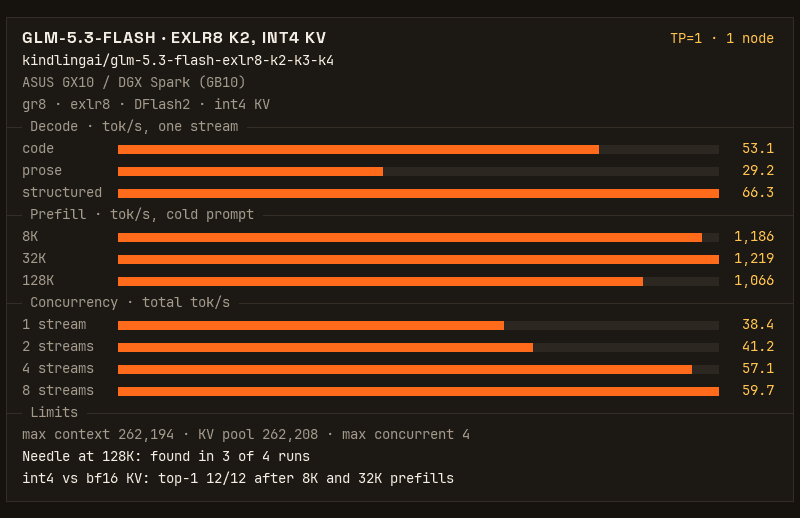
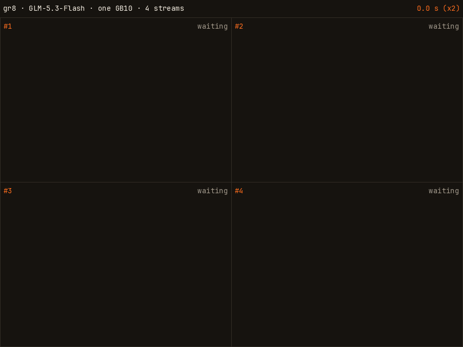

# KindlingAI: GLM-5.3-Flash EXLR8 on one DGX Spark

GLM-5.3-Flash on one DGX Spark (GB10, 128 GB), served by [gr8](https://github.com/kindlingai/gr8)
from the K2 width of [kindlingai/glm-5.3-flash-exlr8-k2-k3-k4](https://huggingface.co/kindlingai/glm-5.3-flash-exlr8-k2-k3-k4):
int4 KV, DFlash2 speculative decoding, four requests at once, and a prompt cache on disk.





## Run it

```bash
git clone --recurse-submodules https://github.com/kindlingai/glm-5.3-flash-exlr8-1x-spark
cd glm-5.3-flash-exlr8-1x-spark
docker compose up -d          # the published image, ghcr.io/kindlingai/glm-5.3-flash-exlr8-1x-spark
docker compose logs -f
docker compose exec gr8 gr8 glm53f smoke
```

`docker compose up -d --build` builds the image on the box instead (about 30 minutes cold). CI builds every push and
publishes main as `latest`, each commit as `sha-<commit>`, and each tag under its name (`.github/workflows/image.yml`).

The API is OpenAI's on port 8100, and the model's name is `glm-5.3-flash` (`glm53f` also works):

```bash
curl -s localhost:8100/v1/chat/completions -H 'Content-Type: application/json' -d '{
  "model": "glm-5.3-flash",
  "messages": [{"role": "user", "content": "Write a haiku about a small computer."}],
  "max_tokens": 512
}'
```

The first boot downloads 87 GB from Hugging Face (the model and the drafter) and
converts the drafter; later boots take about 45 s. Stop any other model on the box first: the weights take 93 GB.

## Knobs

In `.env` next to `compose.yaml` (see `.env.example`):

| knob | default | |
|---|---|---|
| `CAP` | `700032` | The KV pool in tokens, shared by the sessions: admission reserves each request's prompt + `max_tokens` from it. About 5 KB of memory a token. |
| `MAX_MODEL_LEN` | `262144` | The longest single request, prompt and output together. At most `CAP` less the guard rows (14 with DFlash2). |
| `DFLASH` | `1` | `1`: a request alone drafts with [DFlash2](https://huggingface.co/incoai/GLM-5.3-Flash-DFlash2) (CC BY-NC-ND 4.0), downloaded and converted on the first boot. A request left alone when the others finish switches to it after 256 tokens of MTP. `0`: MTP only, nothing downloaded. |
| `MENTAT` | `0` | `1`: register with the mentat cluster through the host's mentat daemon, in group `GROUP` (`gr8-glm53f-1x`). |

`CAP` was tuned on a standard DGX OS install. If you are running Kindling Spark OS (https://github.com/kindlingai/kindling-spark-os)
you may be able to raise `CAP` to `1000000`.

The image pins the weights to the Hugging Face commits measured below: the release at
[`867580a`](https://huggingface.co/kindlingai/glm-5.3-flash-exlr8-k2-k3-k4/tree/867580abd28d142bb4c56218bb81a752b7dea988)
and the drafter at [`bf582e4`](https://huggingface.co/incoai/GLM-5.3-Flash-DFlash2/tree/bf582e4eacc1810f76656d1811693ff6c6737d2a).
Set `MODEL` or `DRAFTER` in `.env` as needed (`https://huggingface.co/<org>/<repo>@<commit>`).

Advanced `gr8` options can be specified `.env` as well: [gr8/KNOBS.md](gr8/KNOBS.md) lists them, and
[gr8/docs/FLASH.md](gr8/docs/FLASH.md) covers GLM-5.3-Flash. The image sets `TP=1`, `SESS=4`, `VARIANT=k2`,
`KV_FORMAT=int4`, the prompt cache (`FLASH_CACHE=aligned`, `KV_STORE=@/etc/gr8/kv-store.yaml`), one prefill lane and a
5 GiB boot floor (`Dockerfile`).

## The prompt cache

A prompt's prefill keeps a checkpoint at its last multiple of 4,096 tokens in the `prompts` volume (`kv-store.yaml`,
64 GB at most). A later prompt with the same start, such as an agent's next turn, prefills only the rest, and the output
is the same bit for bit. Checkpoints outlive restarts (a new engine build, release or `CAP` starts empty), and a copy
stays in RAM the box is not using, which the kernel takes back when it needs it.

## More numbers

The card above is one `gr8 glm53f bench` run of the image's defaults (`kindling.json`; regenerate it with
`python3 gr8/bench/bench.py kindling REPORT.json --out kindling.json --config-id tp1`, from kindlingai/gr8#354). The rest, from the same box
(one GX10 on kindling spark-os, clocks uncapped, the bench cooling to 55 C before each stage):

| | |
|---|---|
| weights on the device | 93.4 GB (K2) |
| KV pool | 700,032 tokens (int4 latent and pooled indexer keys, 3.5 GB), shared by up to 4 sessions; a request past 32K decodes alone (gr8's `SHARE_LIMIT`) |
| longest request | 262,144 tokens, prompt and output together (`MAX_MODEL_LEN`) |
| from the prompt cache | 32K prompt 0.25 s and 240K prompt 5.7 s to the first token |
| int4 KV against bf16 KV | next-token KL after 8K and 32K prefills: mean 0.013, median 0.0004, top-1 12/12 |
| lowest free memory | 3.9 GiB on kindling spark-os under a 672K prompt at `CAP` 700,032 (about 2 GiB less on DGX OS) |
| a 672K prompt (with `MAX_MODEL_LEN` raised) | 901 s to the first token, 16 tok/s decode after it, 2.7 s from the prompt cache |
| boot | 45 s from the cache; the first boot downloads 85 GB at about 160 MB/s (8 min) and converts the drafter in 5 s |

The GPU reaches 90 C in a 128K prefill, and the bench then holds it at 1,800 MHz, so the long prefills are partly capped.
